<div align="center">


# Heros PDF — PDF Studio Extension

### The fastest, most private, most beautiful PDF viewer and editor for your browser.
### Read - Annotate - Edit - Merge - Split - Search - 100% Local - Free - Unlimited

<br/>

[](./pdf-studio-extension/manifest.json)
[](https://developer.chrome.com/docs/extensions/mv3/)
[](#privacy-and-security)
[](#why-heros-pdf)
[](#themes-and-eye-comfort)
[](#responsive-and-mobile-first)

<br/>

[](https://mozilla.github.io/pdf.js/)
[](https://pdf-lib.js.org/)
[](#installation-30-seconds)
[](#installation-30-seconds)
[](#installation-30-seconds)
[](./LICENSE)

**Website:** `https://ahmedbakr78.github.io/Heros_PDF/`  |  **Extension folder:** [`pdf-studio-extension/`](./pdf-studio-extension/)  |  **Issues:** [Report a bug](https://github.com/Ahmedbakr78/Heros_PDF/issues/new/choose)  |  **Feature request:** [Request it](https://github.com/Ahmedbakr78/Heros_PDF/issues/new/choose)

> **One-line description for the GitHub About box (copy-paste, no emojis):**
> `Heros PDF — fast, private, beautiful PDF viewer and editor. Read, annotate, merge, split, search. Dark + Light, mobile-ready, 100% local, free and unlimited.`

</div>

---

## Table of Contents

- [Description (short, medium, long)](description-short-medium-long)
- [Why Heros PDF?](#why-heros-pdf)
- [Demo / How it looks](#demo--how-it-looks)
- [Feature Universe — The Complete List](#feature-universe--the-complete-list)
- [Heros PDF vs Everyone Else](#heros-pdf-vs-everyone-else)
- [Architecture and Diagrams](#architecture-and-diagrams)
- [Data Flow and Rendering Pipeline](#data-flow-and-rendering-pipeline)
- [Annotation Engine](#annotation-engine)
- [Search Engine](#search-engine)
- [Edit Engine (Merge / Split / Rotate / Watermark)](#edit-engine-merge--split--rotate--watermark)
- [Privacy and Security](#privacy-and-security)
- [Installation — 30 Seconds](#installation--30-seconds)
- [Usage Guide](#usage-guide)
- [Keyboard Shortcuts](#keyboard-shortcuts)
- [PDF Operations Handbook](#pdf-operations-handbook)
- [Themes and Eye Comfort](#themes-and-eye-comfort)
- [Responsive and Mobile-First](#responsive-and-mobile-first)
- [Performance Engineering](#performance-engineering)
- [Design System and Visual Language](#design-system-and-visual-language)
- [Internals — Inside app.js](#internals--inside-appjs)
- [Release and Publishing Pipeline](#release-and-publishing-pipeline)
- [Contribution Workflow](#contribution-workflow)
- [Compatibility Matrix](#compatibility-matrix)
- [Project Stats](#project-stats)
- [Repository Structure](#repository-structure)
- [Tech Stack](#tech-stack)
- [Roadmap](#roadmap)
- [Contributing](#contributing)
- [FAQ — 25 Questions](#faq--25-questions)
- [Changelog and Releases](#changelog-and-releases)
- [GitHub Topics, About and Website Setup](#github-topics-about-and-website-setup)
- [License and Credits](#license-and-credits)

---

## Description (short, medium, long)

Pick the length you need. All three are emoji-free and ready to paste into GitHub About, the website meta tags, or a store listing.

**Short (1 line, About box):**

```text
Heros PDF — fast, private, beautiful PDF viewer and editor. Read, annotate, merge, split, search. Dark + Light, mobile-ready, 100% local, free and unlimited.
```

**Medium (1 paragraph, social shares):**

```text
Heros PDF (PDF Studio) is a fast, private, beautiful PDF viewer and editor for your
browser. Open any PDF instantly with continuous scroll, thumbnails, bookmarks and
full-text search, then annotate with 11 tools and edit with merge, split, rotate,
watermark and page numbers. Dark + Light, mobile-ready, silent instant boot,
100% local and offline. No account, no tracking, no limits. Free forever (MIT).
```

**Long (full product description, website hero + store listing):**

```text
Heros PDF replaces the basic built-in PDF viewer with a complete studio.
VIEW: continuous or single-page reading, fit-width / fit-page / 10-800% zoom,
2-up spread with adjustable gap, auto-scroll presentation, resume-last-page,
encrypted-PDF unlock, drag-and-drop open, open-from-URL and demo file.
ORGANIZE: lazy page thumbnails, nested outline bookmarks, full-document search
index with context snippets, recent files with time-ago, per-document page
bookmarks, annotation notes list, profile card with reading stats.
ANNOTATE: select, highlight, underline, strike, pen, arrow, line, rectangle,
ellipse, text boxes, one-click stamps and eraser, with undo/redo, opacity and
size controls, per-document auto-save and burn-into-PDF export.
EDIT: merge many PDFs, split and extract with 1-3,5,8-10 range syntax, delete,
reorder, duplicate, rotate uniform or per-page, watermark, page numbers, fix page
size, quality slider. COMFORT: dark and light UI (system-aware), night / sepia /
dim page modes, focus mode, copy-and-share page text, full
keyboard map, reduced-motion support. INTEGRATION: Manifest V3 service worker,
auto-open of file:// and https:// PDFs with separate toggles, right-click
"Open with Heros PDF", compact popup control center. PRIVACY: 100% local and
offline, blob: URLs only, IndexedDB stores only your recents and annotations,
no server, no analytics, no account. PRICE: free forever, unlimited pages,
merges and annotations, no watermark, no daily quota, MIT open source.
Stack: PDF.js for viewing, pdf-lib + qpdf.wasm for editing, zero frameworks.
Browsers: Chrome, Edge, Brave, Opera, Arc and any Chromium browser.
```

---

## Why Heros PDF?

Most PDF extensions are either slow, plain-looking, paid, or upload your files to a server.

Heros PDF is the opposite:

| Principle | What it means in practice |
|---|---|
| Fastest ever | Lazy page rendering, IntersectionObserver preloading, DPR-capped canvas, chunked size detection, silent instant boot with no distracting animations |
| Careful design | Ultra-rounded floating cards, pill toolbars, floating sidebar, dark + light + night + sepia, icon-everywhere UI |
| 100 percent private | Files never leave your device. No account, no tracking, no analytics, no server. IndexedDB only stores your recents and annotations locally |
| Free and unlimited | No page limits, no watermarks, no "3 free tasks per day", no premium lock. Merge 500 pages if you want |
| Mobile-ready | Mobile-full layout down to 360px, touch-ready annotation layer, drawer sidebar, quick-action row |
| Power-user | Full-text search index, outline and bookmarks, thumbnails, stopwatch and todo tools, auto-scroll presentation, 2-up spread, custom gaps, stamps, page numbers, watermarks |

---

## Demo / How it looks

> Preview renders live in `docs/screenshots/` (regenerate with
> `python3 assets/generate-screenshots.py`, or replace the files 1:1 with real
> captures — same names). The website shows the same images.

| Light mode | Dark mode |
|---|---|
| 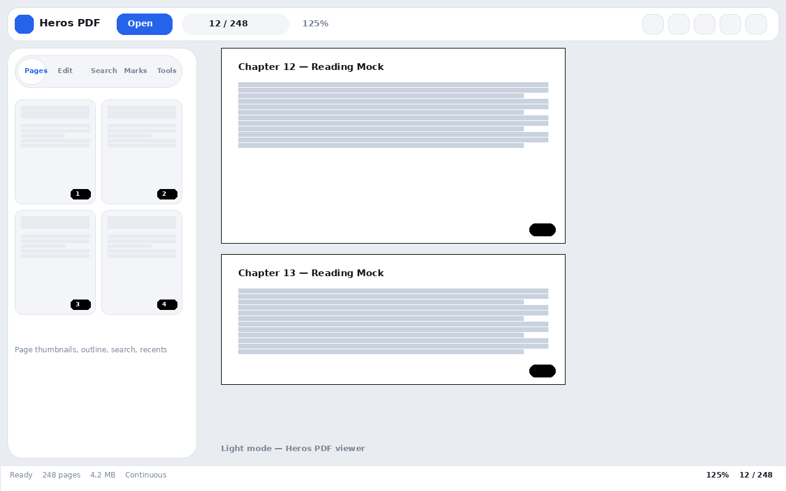 | 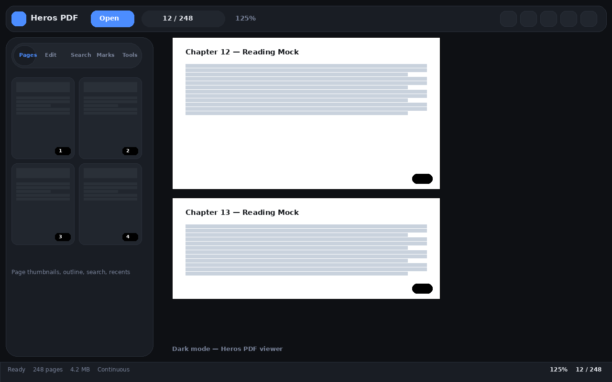 |

| Sidebar — Pages / Outline / Search / Recent | Annotate Studio |
|---|---|
| 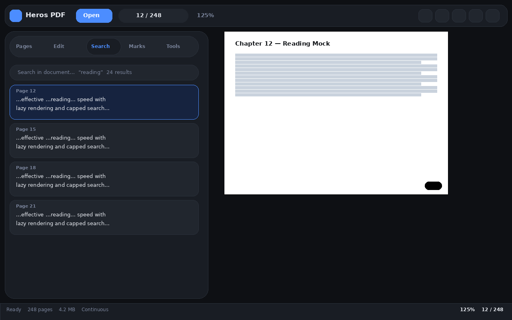 | 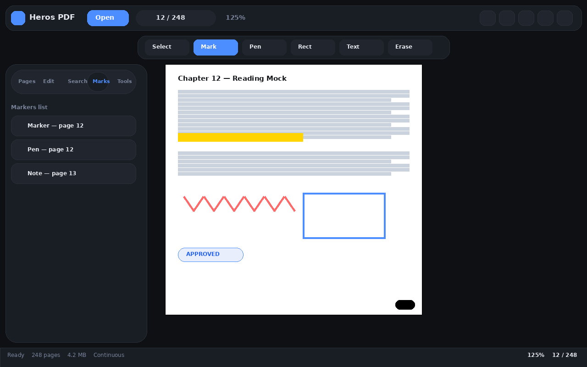 |

| Edit Studio | Mobile |
|---|---|
| 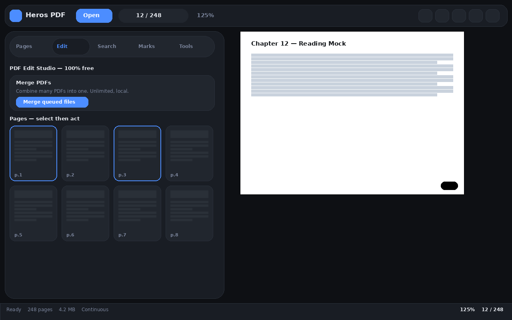 | 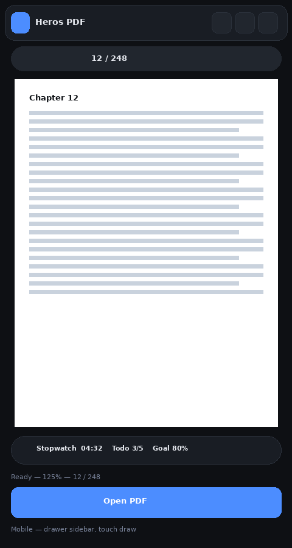 |

**App shell at a glance:**

```text
+---------------------------------------------------------------+
| Topbar (floating rounded card)                                |
| [Heros PDF] [Open] [First Prev 12 / 248 Next Last] [- 125% +] |
+------------+--------------------------------------------------+
| Sidebar    |  Viewer (continuous scroll, lazy pages)          |
| +--------+ |   +------------------+                            |
| | Pages  | |   |   Page 12        |  canvas + text    |
| | Outln  | |   |  selectable text |  + links + annot |
| | Search | |   +------------------+                            |
| | Recent | |   +------------------+                            |
| +--------+ |   |   Page 13        |                            |
|            |   +------------------+                            |
+------------+--------------------------------------------------+
| Statusbar: Ready - 248 pages - 4.2 MB - Continuous            |
+---------------------------------------------------------------+
```

---

## Feature Universe — The Complete List

The printable checklist also lives in [`docs/FEATURES.md`](./docs/FEATURES.md).

### 1. Viewing and Navigation
- [x] Continuous scroll + Single-page mode
- [x] Fit-width / Fit-page / Custom zoom (10 percent – 800 percent)
- [x] Rotate 90 / 270 degrees (view + permanent rotation on export)
- [x] First / Prev / Next / Last + direct page-number jump
- [x] 2-up Spread mode with adjustable page gap
- [x] Auto-scroll presentation mode with speed control
- [x] Focus mode (hides sidebar)
- [x] Fullscreen + Presentation (black) mode
- [x] Remember last page per document (resume reading)
- [x] Clickable internal links + outline destinations + external links
- [x] Encrypted PDF unlock with friendly password modal
- [x] Drag and drop anywhere to open, file picker, open-from-URL, demo file

### 2. Sidebar Studios (4 panes + extras)
- [x] **Pages** — lazy thumbnails with active-page ring
- [x] **Outline** — nested bookmarks tree, click-to-jump
- [x] **Search** — full-document index, 800-result cap, context snippets, prev/next match jumping, case + whole-word options
- [x] **Recent** — IndexedDB recents with name, size, time-ago, one-click reopen, clear-all
- [x] **Bookmarks** — per-document page bookmarks (star any page)
- [x] **Notes / Annotations list** — every stroke listed, click-to-jump, delete
- [x] **Profile card** — avatar, name, color, stats (docs opened, pages read)
- [x] **Settings** — HQ render, resume reading, auto-open toggles, page mode, spread, gap

### 3. Annotate Studio (the power part)
- [x] 11 tools: Select, Highlight, Underline, Strike, Pen, Arrow, Line, Rect, Ellipse, Text, Eraser
- [x] Color swatches + custom color picker + size slider + opacity slider
- [x] One-click stamps: APPROVED, DRAFT, CONFIDENTIAL, SIGN HERE
- [x] Text-box annotations with custom font size
- [x] Undo / Redo stacks (full history)
- [x] Selection mini-toolbar: select any rendered text → Highlight / Underline / Copy in one tap
- [x] Auto-saved to IndexedDB per document (survives reload), export burns annotations into the PDF
- [x] Touch-ready: touch-action none overlay, DPR-aware crisp strokes

### 4. Edit Studio (powered by pdf-lib + qpdf + NevaiOps port)
- [x] Merge multiple PDFs (drop a pile → one file)
- [x] Split / extract pages (`1-3,5,8-10` range syntax)
- [x] Delete pages (visual multi-select grid)
- [x] Reorder / duplicate pages
- [x] Rotate uniform (90/180/270) + per-page rotation map
- [x] Add watermarks (diagonal, opacity, custom text)
- [x] Add page numbers (9 positions, custom margins, font size)
- [x] Fix / normalize page size (A4, Letter, and more)
- [x] Compress-aware export quality slider
- [x] Repair pass via qpdf.wasm where available

### 5. Reading Comfort and Accessibility
- [x] Dark / Light instant toggle (system-aware, persisted)
- [x] Night-pages (inverted canvas), Sepia, Dim — eye-comfort page modes
- [x] Copy-and-share page text (one click)
- [x] Fully keyboard-navigable, focus-visible rings, prefers-reduced-motion respected
- [x] Silent instant boot (boot class disables boot animations — no motion jank)

### 6. Browser Integration
- [x] Manifest V3, service-worker background
- [x] Auto-open `file://*.pdf` + `https://*.pdf` (separate toggles in popup)
- [x] Context menu: "Open with Heros PDF" on any link or page
- [x] Popup control center (280px, switches + open button)
- [x] `chrome.storage.local` prefs, "Allow access to file URLs" helper note

### 7. Free Power — No Limits
- [x] No accounts, no paywall, no watermark, no daily quota
- [x] Unlimited pages, unlimited merges, unlimited annotations
- [x] Works offline after install (all vendor files vendored locally)

### 8. Productivity Studio — Stopwatch, Counters, Tracker, Todo
- [x] Stopwatch with Start/Pause/Lap/Reset and 200-lap history, survives reload
- [x] Unlimited named counters with custom step, rename, reset, delete
- [x] Reading tracker: automatic per-file and per-day time, streaks, daily goal bar
- [x] Todo: file-scoped and global tasks, filters, clear-done, TXT export
- [x] One-file tools backup/restore/reset, included in full backup, T shortcut

---

## Heros PDF vs Everyone Else

| Capability | Heros PDF | Built-in Chrome viewer | Typical "free" web tool |
|---|---|---|---|
| 100 percent local / offline | Yes | Yes | No, uploads to server |
| Dark + Light + Night + Sepia | Yes, 4 modes | No | No |
| Annotate (11 tools) + save | Yes | No | Partial, often paywalled |
| Merge / Split / Watermark / Page numbers | Yes, unlimited | No | Partial, daily quota |
| Full-text search + outline + thumbnails | Yes | Partial | Partial |
| Mobile-ready + touch draw | Yes | Partial | Partial |
| Price | Free forever | Free | Freemium |
| Open source | Yes, MIT | No | No |

---

## Architecture and Diagrams

### Diagram 1 — System overview

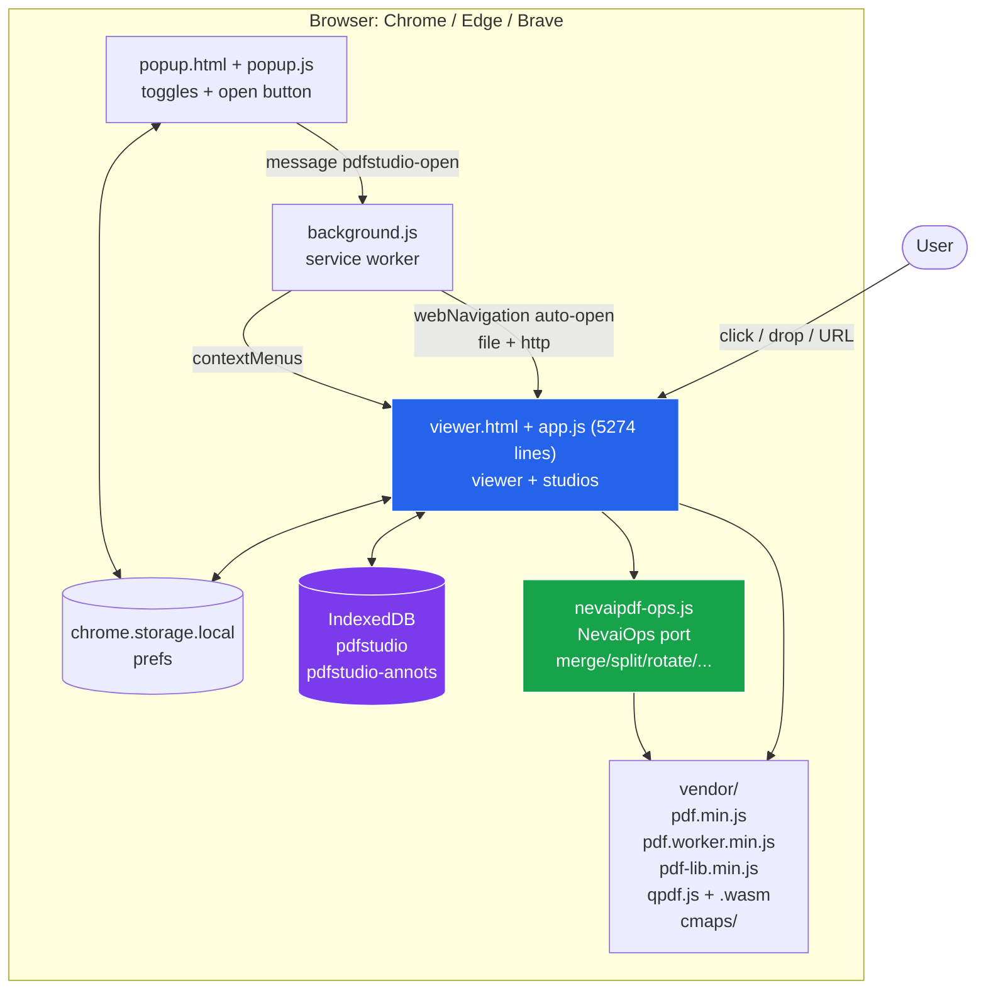

### Diagram 2 — Folder map

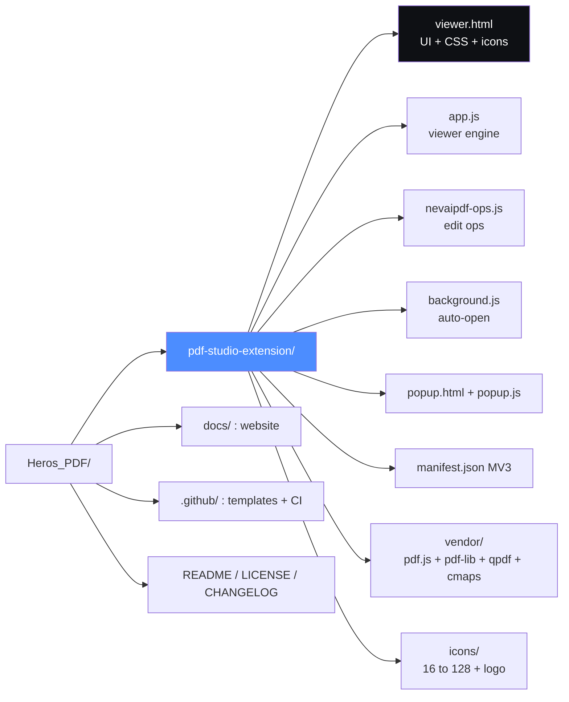

### Diagram 3 — Extension lifecycle (install to reading)

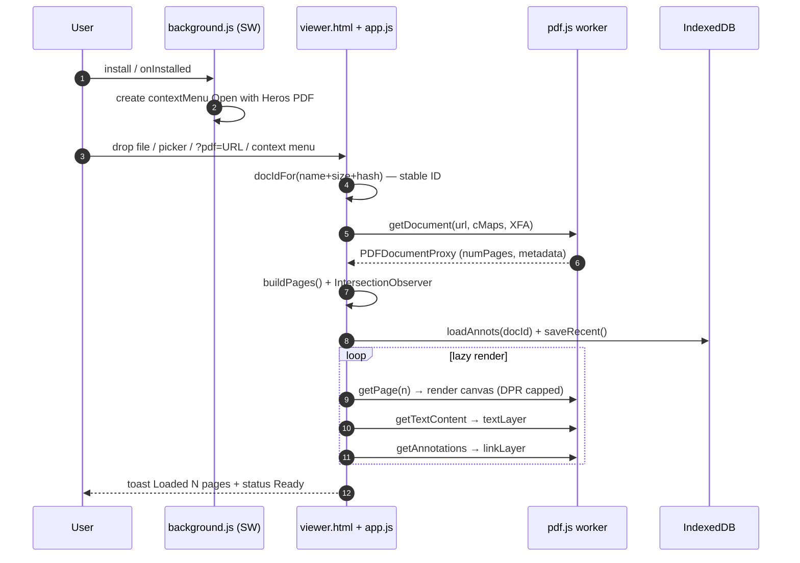

### Diagram 4 — Storage and privacy (nothing leaves the device)

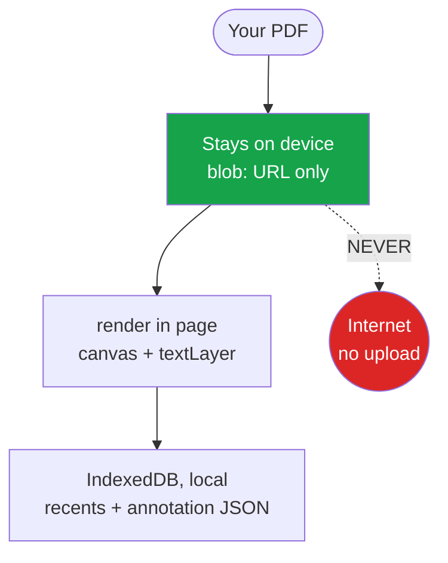

---

## Data Flow and Rendering Pipeline

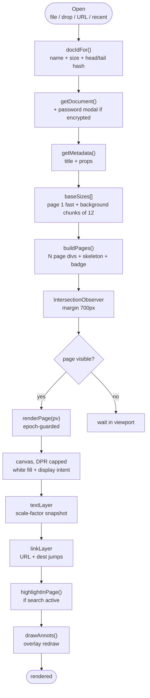

**Key engineering decisions (why it is fast):**

1. **Epoch guard** — every `layout()` bumps `S.epoch`; in-flight renders with a stale epoch abort instead of painting the wrong zoom.
2. **Scale snapshot** — `renderPage` snapshots scale and rotation before `await`, passes it to `buildTextLayer`, so text never drifts after fast zoom.
3. **Observer preloading** — `rootMargin: 700px` renders before you scroll there; `renderVisible(true)` on zoom or rotate re-queues only visible pages.
4. **DPR cap 2** — retina-crisp without 3x memory blowup.
5. **Chunked `computeAllSizes`** — 12 pages per idle chunk, mixed-size PDFs get exact layout without blocking.
6. **Silent boot** — boot class disables first-paint animations, killing load jank.
7. **Capped search** — index capped at 800 hits, list renders first 300, rest counted.
8. **CSS containment** — `content-visibility: auto` skips off-screen paint.

---

## Annotation Engine

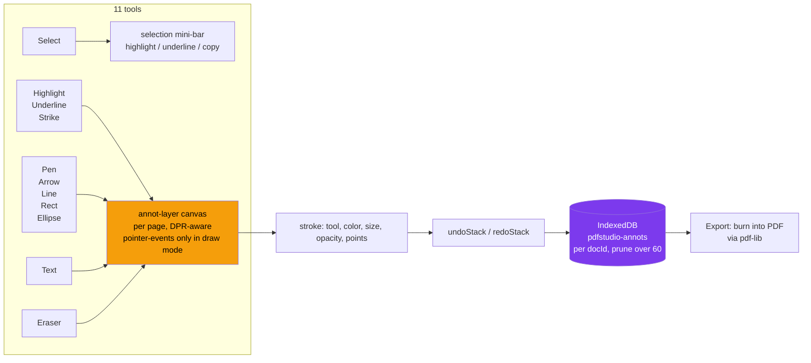

State shape (simplified from `app.js`):

```js
S.annots = { 12: [ {tool:'pen', color:'#ffd400', size:8, opacity:1, points:[...]}, ... ] }
S.tool, S.annotColor, S.annotSize, S.annotOpacity, S.undoStack, S.redoStack
pv.viewport  // recomputed synchronously on layout() so strokes never drift
```

---

## Search Engine

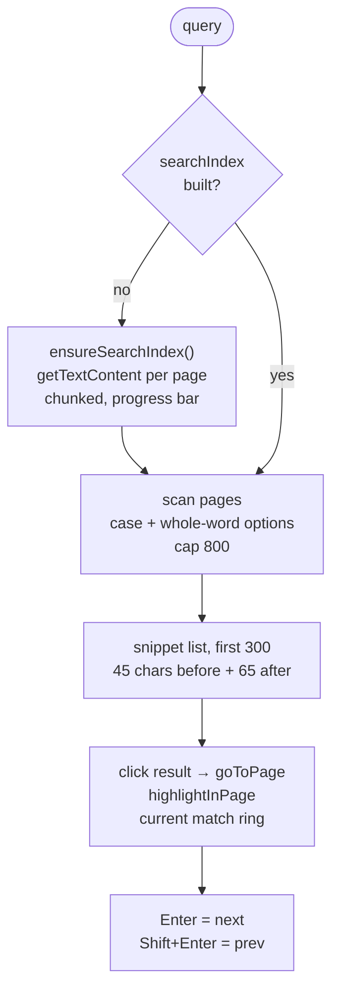

Notes:

- Index is plain joined text per page (`items.map(str).join(' ')`, whitespace collapsed).
- Whole-word uses a word-boundary regex with escaped input; on regex failure it falls back to plain substring.
- Highlights are `mark.hl` nodes inside the textLayer; the current match gets `mark.hl.current`.

---

## Edit Engine (Merge / Split / Rotate / Watermark)

All edit ops live in [`nevaipdf-ops.js`](./pdf-studio-extension/nevaipdf-ops.js) (`window.NevaiOps` namespace — a vanilla-JS port of NevaiPDF `pdf-operations.ts`, MIT).

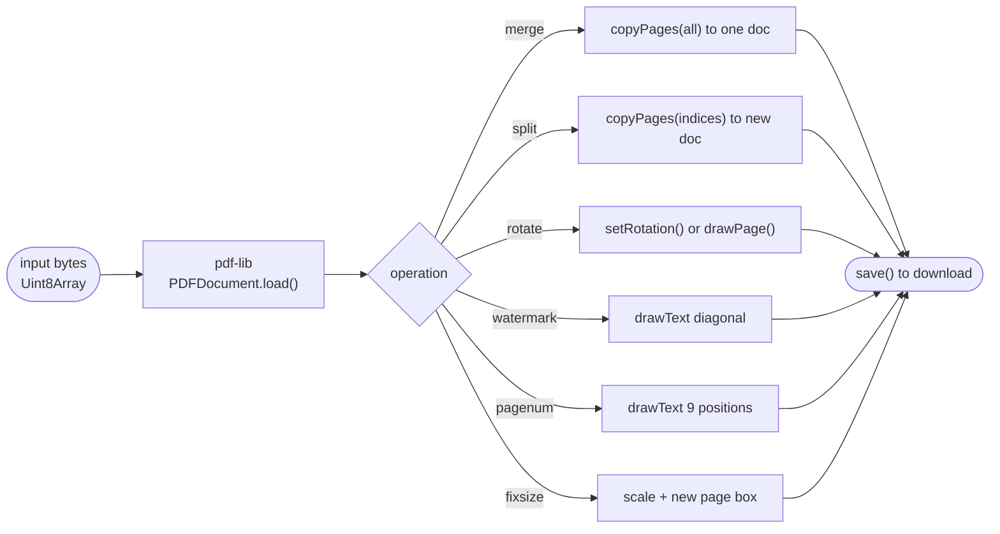

**Range syntax** (split / delete / extract): `1-3,5,8-10` — 1-based, inclusive, commas + dashes, spaces ignored.

```js
// Example: use the engine from the console or your own page
const { mergePdfs, splitPdf, rotatePdfUniform } = window.NevaiOps;
const a = new Uint8Array(await fileA.arrayBuffer());
const b = new Uint8Array(await fileB.arrayBuffer());
const merged = await mergePdfs([a, b]);          // Uint8Array
NevaiOps.downloadFile(merged, 'merged.pdf');     // triggers download
```

---

## Privacy and Security

- **No servers, no analytics, no accounts.** See [`SECURITY.md`](./SECURITY.md).
- Permissions are minimal: `contextMenus` (right-click), `webNavigation` (auto-open PDFs), `storage` (prefs). `<all_urls>` is only used to detect `*.pdf` navigations — never to read page content.
- Content-Security-Policy: `script-src 'self' 'wasm-unsafe-eval'` (wasm needed for qpdf repair).
- To report a vulnerability, see [`SECURITY.md`](./SECURITY.md) — please do not open a public issue.

Threat model in one table:

| Asset | Where it lives | Who can see it |
|---|---|---|
| Your PDF bytes | Memory + `blob:` URL, your device only | Only you |
| Recents (name, size, last page) | IndexedDB `pdfstudio`, your profile only | Only you |
| Annotations (strokes JSON) | IndexedDB `pdfstudio-annots`, your profile only | Only you |
| Preferences | `chrome.storage.local`, your profile only | Only you |
| Network | Nothing sent | Nobody |

---

## Installation — 30 Seconds

### Option A — Load unpacked (recommended for now)

```bash
# 1. Clone
git clone https://github.com/Ahmedbakr78/Heros_PDF.git
cd Heros_PDF

# 2. Open Chrome/Edge/Brave → chrome://extensions
# 3. Enable "Developer mode" (top-right)
# 4. "Load unpacked" → select the folder:
#    Heros_PDF/pdf-studio-extension/
# 5. Pin Heros PDF to the toolbar. Done!
```

Step-by-step with checks:

1. Clone or download ZIP and unzip. Confirm `pdf-studio-extension/manifest.json` exists.
2. Open `chrome://extensions`, enable Developer mode.
3. Click Load unpacked, pick `pdf-studio-extension/`. The Heros PDF card appears with version 2.3.2.
4. Click the puzzle icon → Pin Heros PDF.
5. Click the Heros PDF icon → popup opens → click Open Heros PDF → viewer opens.

### Option B — Open the viewer directly (no install)

Just open [`pdf-studio-extension/viewer.html`](./pdf-studio-extension/viewer.html) in a browser, or serve it:

```bash
cd pdf-studio-extension
python3 -m http.server 8000
# → http://localhost:8000/viewer.html
```

### Enable local-file auto-open (important for `file://` PDFs)

1. Go to `chrome://extensions` → **Heros PDF** → **Details**
2. Enable **"Allow access to file URLs"**
3. In the popup, turn on **Auto-open local PDFs**

> Without step 2, Chrome never tells extensions about `file://` navigations (Chrome security rule).

Full illustrated guide: [`docs/INSTALLATION.md`](./docs/INSTALLATION.md).

---

## Usage Guide

| I want to… | How |
|---|---|
| Open a PDF | Click Open / drag and drop anywhere / Ctrl+O / right-click any PDF link → Open with Heros PDF |
| Jump pages | Type number in `12 / 248` box + Enter, or Arrow keys, Home, End |
| Search | Ctrl+F, type, Enter = next, Shift+Enter = prev. Toggles for case + whole word |
| Annotate | Click Annotate → pick tool → draw on page. Ctrl+Z / Ctrl+Shift+Z undo/redo |
| Highlight selected text | Drag-select text → mini-bar pops → Highlight / Underline / Copy |
| Bookmark a page | Click the bookmark button in the topbar (per-document, survives reload) |
| Merge PDFs | Sidebar Edit → Merge → drop 2+ files → Merge and Download |
| Split / extract | Sidebar Edit → Split → enter `1-3,5,8-10` → Extract |
| Watermark | Sidebar Edit → Watermark → text + opacity → Apply and Download |
| Page numbers | Sidebar Edit → Page numbers → position → Apply |
| Copy page text | Hub → Page text → Copy text (or C key menu entry) |
| Auto-scroll | Statusbar play button → speed slider, click again to stop |
| Change theme | Moon/sun button (instant, persisted, system-aware) |
| Night reading | More menu → Page mode → Night / Sepia / Dim |
| Print | Ctrl+P or More → Print (uses native print with current rotation) |
| Download | Download button (original or edited bytes) |
| Time a session | Tools tab → Stopwatch → Start/Lap, or press T |
| Count anything | Tools tab → Counters → Add, plus/minus by step |
| Track reading | Tools tab → Reading tracker (automatic) + daily goal slider |
| Manage tasks | Tools tab → Todo (This file or Everything), Enter to add |

Long version with screenshots: [`docs/USER_GUIDE.md`](./docs/USER_GUIDE.md).

---

## Keyboard Shortcuts

| Keys | Action | Keys | Action |
|---|---|---|---|
| Ctrl+O | Open file | Ctrl+F | Search |
| Left / Right | Prev / next page | Home / End | First / last page |
| + / - / 0 | Zoom in / out / reset | Ctrl+B | Toggle sidebar |
| Ctrl+Z / Ctrl+Shift+Z | Undo / redo annotation | Delete | Delete selected edit pages |
| F | Fit width | R | Rotate right |
| T | Productivity tools | Space / Shift+Space | Scroll down / up |
| Ctrl+P | Print | F11 | Fullscreen |
| Esc | Close modal / menu | - | - |

Full list is also in-app: More → Keyboard shortcuts.

---

## PDF Operations Handbook

| Operation | Input | Output | Function |
|---|---|---|---|
| Merge | `Uint8Array[]` | one `Uint8Array` | `mergePdfs(list)` |
| Split | bytes + `int[]` | one `Uint8Array` | `splitPdf(bytes, indices)` |
| Rotate uniform | bytes + degrees | new bytes | `rotatePdfUniform(bytes, angle)` |
| Rotate per-page | bytes + `map[i]` | new bytes | `rotatePdfPages(bytes, map)` |
| Watermark | bytes + text + opacity | new bytes | `addWatermark(bytes, text, opts)` |
| Page numbers | bytes + position | new bytes | `addPageNumbers(bytes, opts)` |
| Fix size | bytes + A4/Letter | new bytes | `fixPageSize(bytes, size)` |

Range parser: `parseRange("1-3,5,8-10", pageCount)` → `[0,1,2,4,7,8,9]`. Out-of-range pages are ignored. Empty input returns an empty selection, never throws.

---

## Themes and Eye Comfort

| Mode | UI | Pages | When to use |
|---|---|---|---|
| Light | White surfaces, blue accent | Normal | Daytime, printing mindset |
| Dark (default) | Dark surfaces, bright blue accent | Normal | Night work, OLED screens |
| Night-pages | Dark UI | Inverted canvas filter | Pure-night reading |
| Sepia | Either UI | Sepia filter | Long book sessions |
| Dim | Either UI | Dimmed brightness | Low light without inversion |

Toggle UI theme with the moon/sun button; page modes live in More → Page mode. Both persist in `chrome.storage.local`.

---

## Responsive and Mobile-First

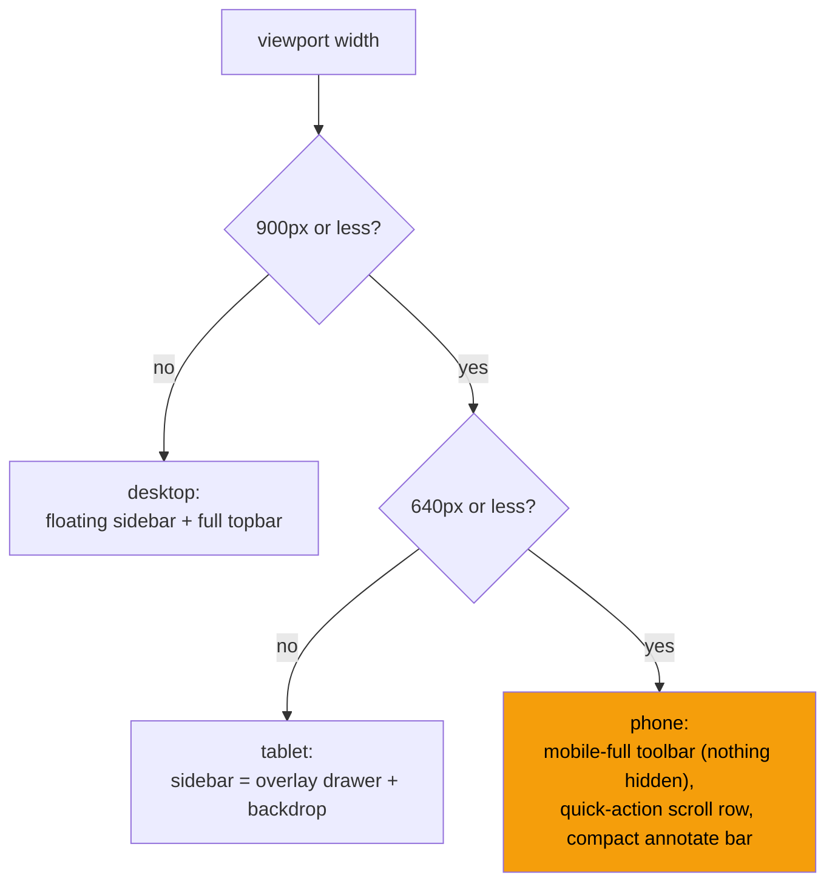

- Breakpoints: 1100px (filetag shrink) → 900px (drawer sidebar) → 640px (mobile-full: compact wrapped toolbar, scrollable quick-action row) → 400px (page total hidden).
- Mobile-full: zero hidden features — First/Last, zoom, Fit, Spread, Rotate, Edit, Bookmark, Night mode and all status-bar actions stay reachable as compact 32px controls.
- Touch: 32px+ hit targets on phones, `touch-action: none` draw layer, momentum scrolling.
- Scrollbars are hidden app-wide (still scrollable) for a clean mobile feel.

---

## Performance Engineering

| Technique | Where | Effect |
|---|---|---|
| Lazy render + 700px preload margin | `buildPages()` + IntersectionObserver | 1000-page PDFs open instantly |
| Epoch-guarded renders | `S.epoch`, `retryRender()` | Never paints stale zoom |
| DPR cap 2 | `renderPage()`, `renderThumb()` | Retina-crisp, bounded memory |
| Chunked size pass (12/chunk) | `computeAllSizes()` | Exact layout, no jank |
| Capped search (800) + snippet list (300) | `runSearch()` | No freeze on short queries |
| content-visibility auto on canvases | CSS | Skipped off-screen paint |
| Silent boot (no boot animations) | boot class | Instant first paint |
| Skeleton per page + progress bar | CSS + JS | Fast perceived speed |

Budgets: open under 1s for a 50-page PDF on a mid laptop; zero scroll jank (only visible pages render); search for "e" in 2000 pages stays responsive; one canvas per rendered page; thumbnails about 150px wide.

---

## Design System and Visual Language

Heros PDF is built on one ultra-rounded design system. Every surface, control and
overlay follows the same contract, so the app feels identical in every view,
every theme and at every width.

### Shell anatomy

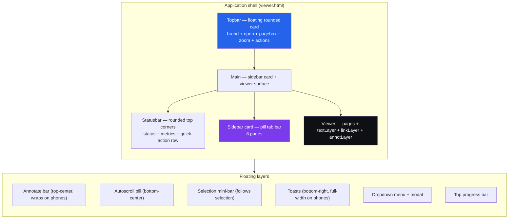

### Design tokens

| Token family | Light | Dark | Notes |
|---|---|---|---|
| Surfaces | `#ffffff`, `#f3f5f8`, `#e8ebf0` | `#191d24`, `#21262e`, `#2a3038` | Three levels: card, control, raised |
| Text | `#14181f`, `#4a5568`, `#7b8697` | `#e7eaf0`, `#b0b9c6`, `#79839a` | Primary, secondary, muted |
| Accent | `#2563eb` | `#4c8dff` | User-changeable (6 presets + custom) |
| Radii | 20 / 14 / 11 / 7 px + 999px pill | same | Cards, buttons, small controls, pills |
| Elevation | 3 shadow levels (sm / md / lg) | same | Page shadow uses a dedicated token |
| Page effects | `--page-bg` white in both themes | same | Pages stay paper-white; the canvas is not themed |

### Roundness contract

| Component | Radius | Component | Radius |
|---|---|---|---|
| Topbar / sidebar / statusbar | 18–20 px | Toasts | 14 px |
| Side tab bar | pill (999px) | Modals | 22 px |
| Pagebox / search box | pill | Empty card / drop overlay | 26 px |
| Thumbnails / result rows / recent rows | 11–16 px | Stat cards / tool cards | 18–20 px |

Sheets of dark theme tokens and page modes live in `pdf-studio-extension/viewer.html`
under "THEME TOKENS"; the app reads them from CSS custom properties, never from JS.

---

## Internals — Inside app.js

One 5,274-line IIFE holds the whole engine. It is organized in numbered sections,
so contributors can navigate by section number.

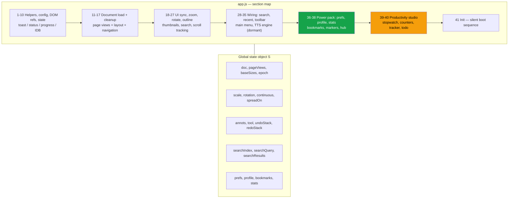

Key invariants (enforced by CI-adjacent review):

1. `renderPage` never reads `S.scale` after an `await` — it uses its snapshot.
2. `layout()` bumps `S.epoch`; anything rendered at a stale epoch re-queues once.
3. Annotation strokes are stored in viewport pixels and redrawn after every layout.
4. Nothing leaves the device: no `fetch` other than the user-provided PDF URL.
5. Every insert/remove of a control keeps mobile parity (no feature is phone-only hidden).

---

## Release and Publishing Pipeline

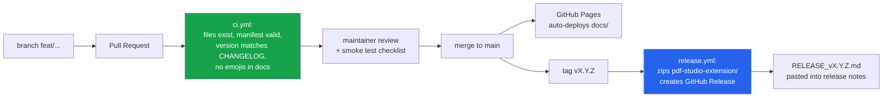

Versioning: SemVer. `patch` = fixes only, `minor` = new features, `major` = breaking
change or manifest break. The manifest version, the CHANGELOG top entry and the
release tag must always agree — CI fails if they do not.

---

## Contribution Workflow

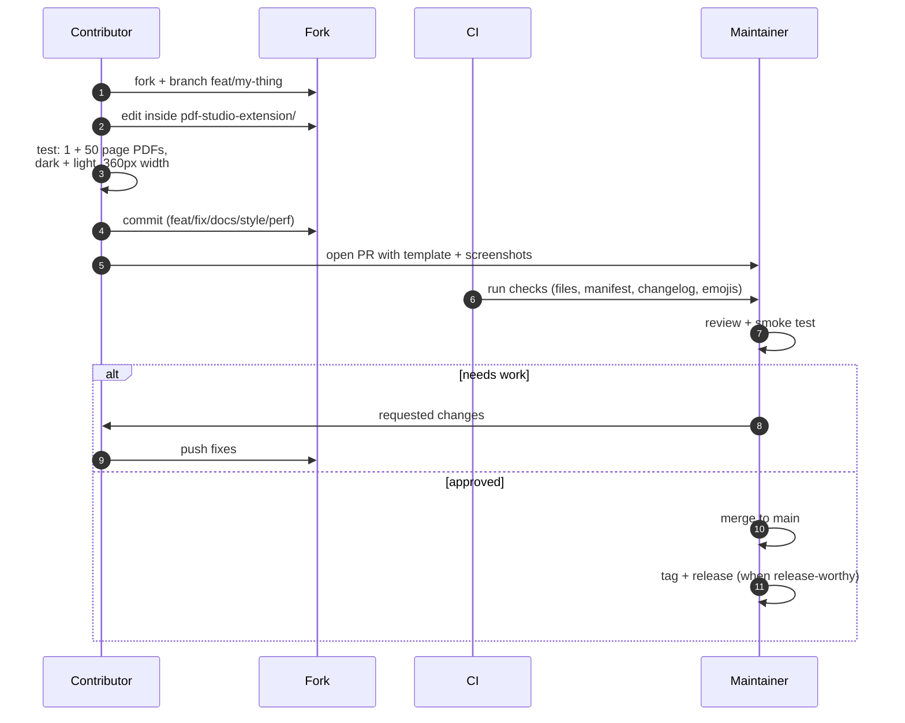

Rules: one logical change per PR, no new permissions without an issue first, no
frameworks or bundlers, no network calls, and never commit private files such as
`todo.txt` (already in `.gitignore`).

---

## Compatibility Matrix

| Platform | Status | Notes |
|---|---|---|
| Chrome (Chromium, MV3) | Supported | Reference target; auto-open works with file-URLs permission |
| Microsoft Edge (MV3) | Supported | Same store rules; `edge://extensions` |
| Brave | Supported | Shields do not block local PDF viewing |
| Opera / Arc / Vivaldi | Supported | Any current Chromium |
| Firefox | Roadmap (v3.0) | Needs MV2-compatible port |
| Chrome Web Store / Edge Add-ons | Roadmap (v3.0) | Packaged release + store listing |
| Desktop vs mobile | Both | Mobile-full since the current build (nothing hidden) |
| Offline | Full | All engines vendored locally after install |

---

## Project Stats

Current numbers (kept in sync by hand; small repo by design):

| Metric | Value |
|---|---|
| Extension code | ~5,400 lines JS + ~1,750 lines HTML/CSS |
| Edit ops engine | ~910 lines (`nevaipdf-ops.js`) |
| Background worker | ~110 lines |
| Documentation | 6 pages + this README (~1,400 lines) |
| Diagrams in README | 13 (all reproducible on any Markdown viewer) |
| Features shipped | 100+ (see `docs/FEATURES.md`) |
| Permissions requested | 3 (`contextMenus`, `webNavigation`, `storage`) |
| Vendored dependencies | pdf.js, pdf-lib, qpdf.wasm, cmaps |
| Runtime dependencies | None — zero frameworks, zero build step |
| Emojis in repo docs | 0 (enforced by CI) |

---

## Repository Structure

```text
Heros_PDF/
├── README.md                        ← you are here (the big one)
├── LICENSE                          ← MIT
├── CHANGELOG.md                     ← every version, newest first
├── CONTRIBUTING.md                  ← how to help
├── CODE_OF_CONDUCT.md               ← be kind
├── SECURITY.md                      ← how to report vulnerabilities
├── SUPPORT.md                       ← where to get help
├── _config.yml                      ← GitHub Pages settings (docs/ site)
├── .gitignore                       ← includes todo.txt (never uploaded)
│
├── pdf-studio-extension/            ← THE EXTENSION (load this folder unpacked)
│   ├── manifest.json                ← MV3, v2.3.2, minimal permissions
│   ├── viewer.html                  ← full UI + ultra-rounded CSS + icon sprite
│   ├── app.js                       ← 5274-line viewer engine
│   ├── nevaipdf-ops.js              ← edit ops port (merge/split/rotate/...)
│   ├── background.js                ← service worker (auto-open + context menu)
│   ├── popup.html / popup.js        ← toolbar popup (toggles + open)
│   ├── icons/                       ← 16/32/48/128 + logo + apple-touch
│   └── vendor/                      ← pdf.js + worker, pdf-lib, qpdf.js/.wasm, cmaps/
│
├── docs/                            ← WEBSITE (GitHub Pages serves this)
│   ├── index.html                   ← landing page (hero + features + install + FAQ)
│   ├── architecture.md              ← deep-dive with diagrams
│   ├── DIAGRAMS.md                  ← every diagram, one printable gallery
│   ├── FEATURES.md                  ← printable feature catalogue
│   ├── INSTALLATION.md              ← illustrated install guide
│   ├── USER_GUIDE.md                ← full usage manual
│   ├── ROADMAP.md                   ← versions, timeline, release process
│   ├── FAQ.md                       ← long-form 30-question FAQ
│   └── screenshots/                 ← light.png dark.png sidebar.png annotate.png edit.png mobile.png
│
├── assets/
│   ├── icons/                       ← repo icon set (brand logo, 16 to 128, apple-touch)
│   ├── banner.svg                   ← social / README banner source (1280x640)
│   ├── generate-screenshots.py      ← regenerates docs/screenshots
│   └── make-icon.py                 ← syncs assets/icons from the app icon set
│
└── .github/
    ├── GITHUB_META.md               ← copy-paste About/description/topics/website/release
    ├── RELEASE_v2.3.2.md            ← release notes for v2.3.2 (paste into GitHub Release)
    ├── RELEASE_TEMPLATE.md          ← template for future release notes
    ├── FUNDING.yml                  ← sponsor button (edit with your links)
    ├── CODEOWNERS                   ← review routing
    ├── PULL_REQUEST_TEMPLATE.md
    ├── ISSUE_TEMPLATE/
    │   ├── bug_report.yml
    │   └── feature_request.yml
    └── workflows/
        ├── ci.yml                   ← lint + structure + emoji check on every push/PR
        └── release.yml              ← auto-zip extension on tag v*
```

Private files that are never committed: `todo.txt`, `todo.md` (both in `.gitignore`).

---

## Tech Stack

| Layer | Technology | Notes |
|---|---|---|
| Rendering | PDF.js 3.11.174 (vendored) | display intent, XFA on, cMaps packed |
| Editing | pdf-lib (vendored) + qpdf.wasm repair | via NevaiOps port of NevaiPDF (MIT) |
| UI | Vanilla HTML/CSS/JS, zero framework | 60fps, no build step, instant load |
| Storage | IndexedDB (`pdfstudio`, `pdfstudio-annots`) + chrome.storage.local | recents, annots, prefs — all local |
| Extension | Manifest V3 service worker | webNavigation + contextMenus + storage |
| Docs/site | GitHub Pages (`docs/`) + Mermaid diagrams | no build, just push |
| CI | GitHub Actions | manifest validation + zip artifact + emoji guard |

---

## Roadmap

Full timeline, version table and the release process: [`docs/ROADMAP.md`](./docs/ROADMAP.md).

- [ ] **v2.4** — Form filling + digital signature pad
- [ ] **v2.5** — OCR for scanned PDFs (wasm, still local)
- [ ] **v2.6** — Split-view (two documents side-by-side) + tab bar
- [ ] **v3.0** — Chrome Web Store publish + Edge Add-ons + Firefox port
- [ ] Wishlist (vote with a thumbs-up on issues): cloud-optional sync, translation overlay, redaction tool

> Have an idea? [Open a feature request](https://github.com/Ahmedbakr78/Heros_PDF/issues/new/choose) — best ideas get built first.

---

## Contributing

We welcome PRs. Small, focused, tested PRs get merged fastest.

1. Read [`CONTRIBUTING.md`](./CONTRIBUTING.md) (5 min)
2. Fork → branch `feat/my-thing` → edit inside `pdf-studio-extension/`
3. Test: load unpacked + open a 50+ page PDF + try dark/light + mobile width
4. PR with screenshot or GIF. CI must be green.

Please follow the [`CODE_OF_CONDUCT.md`](./CODE_OF_CONDUCT.md).

---

## FAQ — 25 Questions

1. **Is it really free?** Yes. MIT-licensed, unlimited, no watermark, no account.
2. **Do my PDFs upload anywhere?** No. Everything runs locally via `blob:` URLs.
3. **Which browsers?** Chrome, Edge, Brave, Opera, Arc, any Chromium. Firefox port on roadmap.
4. **Why does `file://` auto-open not work?** Enable "Allow access to file URLs" in `chrome://extensions`.
5. **CORS error on URL open?** Some hosts block cross-origin fetch. Download the file, then drag and drop it.
6. **Password PDFs?** Supported — you get an unlock modal.
7. **Max file size?** Tested to 500+ MB / 2000+ pages; lazy rendering keeps it smooth.
8. **Are annotations saved?** Yes, per-document in IndexedDB; export burns them into the PDF.
9. **Can I merge scanned PDFs?** Yes — merge/split/rotate work on any PDF.
10. **Mobile?** Yes — mobile-full: drawer sidebar, every toolbar control, quick-action row, touch drawing.
11. **Dark mode?** UI dark/light + Night/Sepia/Dim page modes.
12. **Copy page text?** Yes — Hub → Page text → Copy text, or the Tools menu entry.
13. **Print?** Yes — prints with current rotation.
14. **Keyboard only?** Yes — see shortcuts table above.
15. **Offline?** Yes after install (all vendor files local).
16. **Why two PDF engines?** PDF.js = viewing; pdf-lib + qpdf = editing. Best of both.
17. **Can I use NevaiOps in my own project?** Yes — MIT, see handbook above.
18. **How do I update?** `git pull`, then `chrome://extensions` → reload. Recents and annots persist.
19. **Found a bug?** [Open a bug report](https://github.com/Ahmedbakr78/Heros_PDF/issues/new/choose) with file size + steps + screenshot.
20. **How can I help?** Star, share, translate, or pick a `good first issue`.
21. **Where is the website?** `https://ahmedbakr78.github.io/Heros_PDF/` (served from `docs/`).
22. **Where are releases?** GitHub Releases, starting with `v2.3.2` + attached zip.
23. **What topics should the repo have?** The 20 topics in `.github/GITHUB_META.md`.
24. **Is todo.txt uploaded?** No — it is deleted locally and listed in `.gitignore`, never committed.
25. **Are there emojis in the repo docs?** No — docs, website and templates are emoji-free by policy (CI checks).

More help: [`SUPPORT.md`](./SUPPORT.md). Install help: [`docs/INSTALLATION.md`](./docs/INSTALLATION.md). Manual: [`docs/USER_GUIDE.md`](./docs/USER_GUIDE.md). Diagrams gallery: [`docs/DIAGRAMS.md`](./docs/DIAGRAMS.md). Roadmap: [`docs/ROADMAP.md`](./docs/ROADMAP.md). Long-form FAQ: [`docs/FAQ.md`](./docs/FAQ.md).

---

## Changelog and Releases

See [`CHANGELOG.md`](./CHANGELOG.md) for every version. Latest:

**v2.3.2** — Ultra-round design system + silent boot + spread/gap engine + selection mini-bar + power-pack sidebar — full notes in [`.github/RELEASE_v2.3.2.md`](./.github/RELEASE_v2.3.2.md).

To publish a release on GitHub: **Releases → Draft new release → tag `v2.3.2` → paste** the file above → attach the zip from CI (`heros-pdf-v2.3.2.zip`).

---

## GitHub Topics, About and Website Setup

**Do not guess — copy-paste from [`./.github/GITHUB_META.md`](./.github/GITHUB_META.md).** It contains:

- Ready-to-paste **About description** (short + medium + long, all emoji-free)
- **Website URL** (`https://ahmedbakr78.github.io/Heros_PDF/`)
- **20 topics** to paste into About settings
- **Social preview** instructions + `assets/banner.svg`
- **Release title + notes** for v2.3.2
- Repo settings checklist (Pages → `docs/`, Issues on, Discussions on, private files check)

Enable the website in 20 seconds: **Settings → Pages → Deploy from branch → `main` + `/docs`** → Save → your site is live at the URL above.

---

## License and Credits

**MIT** — Copyright 2026 Ahmed Bakr (Ahmedbakr78). See [`LICENSE`](./LICENSE). Do anything, just keep the notice.

Built on giants:

- [PDF.js](https://mozilla.github.io/pdf.js/) (Apache-2.0, Mozilla)
- [pdf-lib](https://pdf-lib.js.org/) (MIT)
- [qpdf / qpdf-wasm](https://github.com/qpdf/qpdf) (Apache-2.0)
- [NevaiPDF pdf-operations](https://github.com/) port (MIT, Nevai Team) — adapted to vanilla JS in `nevaipdf-ops.js`

---

<div align="center">

### If Heros PDF saves you time, star it — it takes 2 seconds and keeps us building.

[](https://github.com/Ahmedbakr78/Heros_PDF/stargazers)
[](https://github.com/Ahmedbakr78/Heros_PDF/fork)
[](https://github.com/Ahmedbakr78/Heros_PDF/issues)

**Made with care by [Ahmed Bakr](https://github.com/Ahmedbakr78) — free forever, private forever.**

</div>
