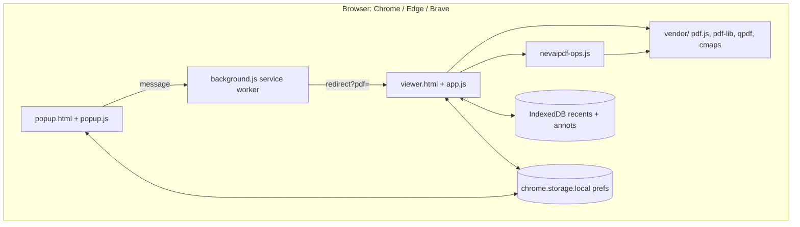
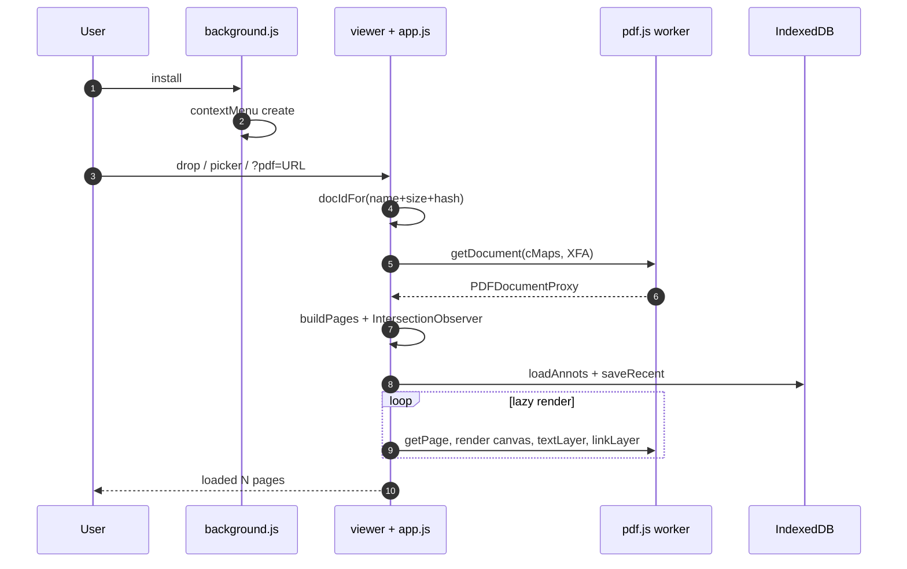
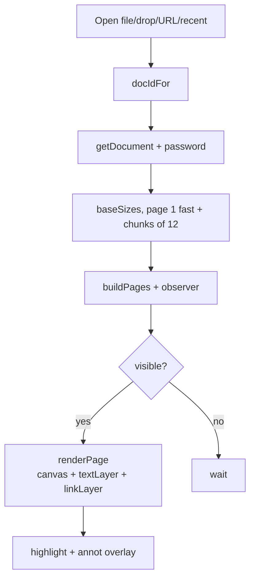
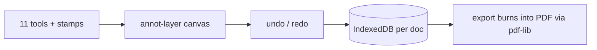
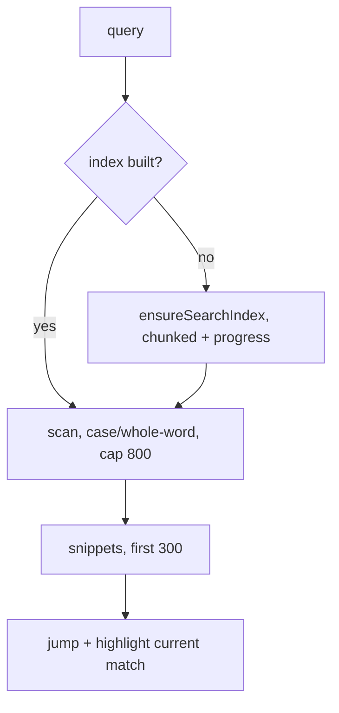
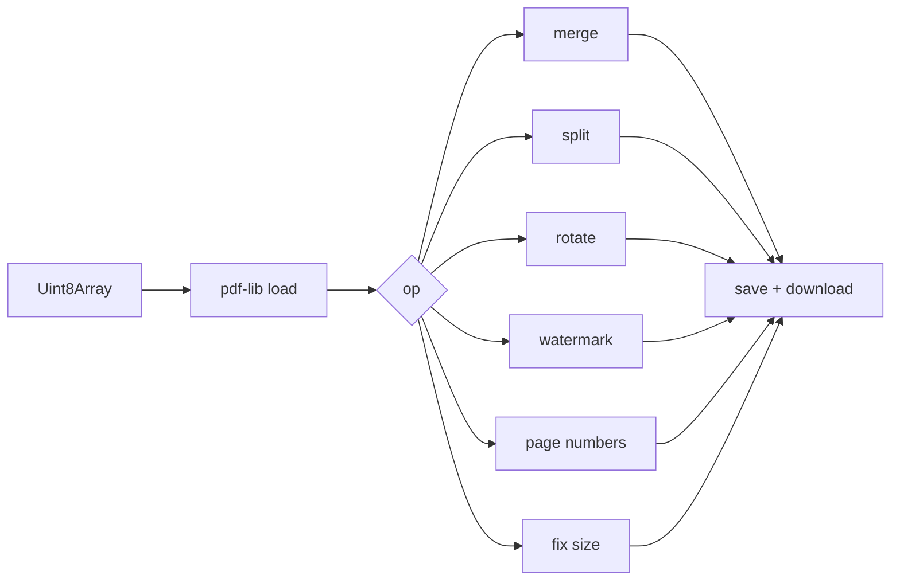
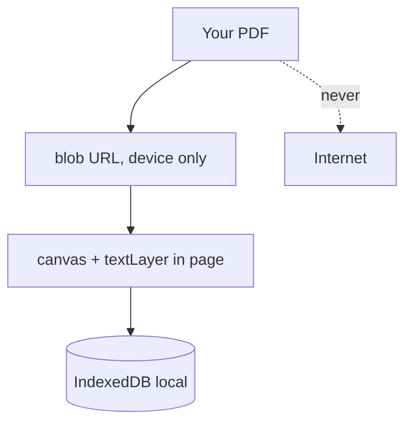
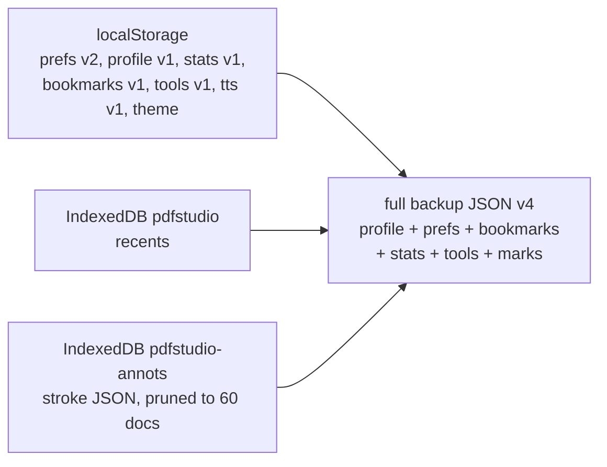
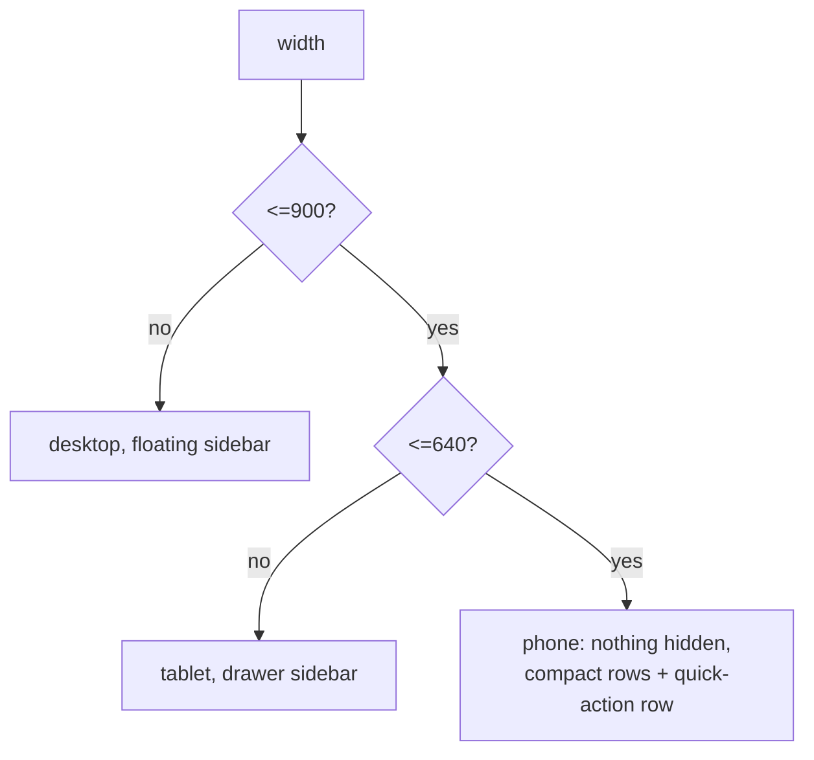
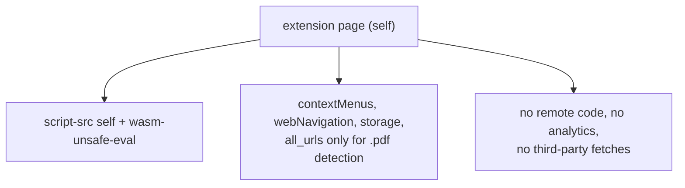

# Diagrams Gallery — Heros PDF

Every diagram in the project, in one printable page. Copy any block into a
GitHub Markdown file, a Mermaid live editor, or `docs/architecture.md` to re-render.
No emojis anywhere in this file.

## 1. System overview (process model)

## 2. Extension lifecycle (install to reading)

## 3. Render pipeline (epoch-guarded)

## 4. Annotation engine

## 5. Search engine

## 6. Edit engine

## 7. Privacy: nothing leaves the device

## 8. Storage schema

## 9. Responsive breakpoints (mobile-full)

## 10. Security boundary

