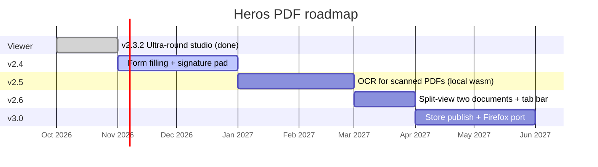

# Roadmap — Heros PDF

Status of every planned version, plus how releases are cut. Dates are targets, not
promises. Vote on features with a thumbs-up on the linked issue to move them up.

## Timeline

## Version table

| Version | Theme | Status | Headline changes |
|---|---|---|---|
| 2.0.0 | Manifest V3 rewrite | Released | Service worker, dark + light themes, auto-open, context menu, popup |
| 2.3.0 | Search + outline + Edit v1 | Released | Outline tree, full-text search pane, merge/split/rotate |
| 2.3.1 | Annotation polish | Released | Undo/redo, eraser, opacity, recent files |
| 2.3.2 | Ultra-round studio | Released (current) | Design system, silent boot, spread + gap, selection mini-bar, power-pack sidebar |
| 2.3.2+ | Productivity studio | In progress (on main) | Stopwatch, counters, reading tracker, todos; read-aloud button removed; mobile-full |
| 2.4 | Forms and signatures | Planned | Acroform filling, drawn signature placement, signature verification hints |
| 2.5 | OCR | Planned | On-device OCR for scanned pages, searchable output layer |
| 2.6 | Multi-document | Planned | Split view, document tabs, cross-file merge by drag between tabs |
| 3.0 | Distribution | Planned | Chrome Web Store listing, Edge Add-ons, Firefox (MV2-compatible) port |

## Wishlist (no version assigned)

- Optional cloud sync (opt-in, still private by default)
- Translation overlay for selected text (local dictionaries)
- Redaction that truly removes text from the content stream, not just a black box
- Export to EPUB/Word for text-heavy files
- Plugin API for custom stamps and tools

## How a release is cut

1. Features land on `main` through PRs (CI checks files, manifest, CHANGELOG, emojis).
2. `CHANGELOG.md` gets a `## [X.Y.Z]` entry; `manifest.json` version is bumped to match.
3. A release-notes file `.github/RELEASE_vX.Y.Z.md` is written from `.github/RELEASE_TEMPLATE.md`.
4. Tag `vX.Y.Z` is pushed → `release.yml` zips `pdf-studio-extension/` and drafts the release.
5. The notes file is pasted into the release body, the zip is attached, latest is set.

Version rules: SemVer — patch = fixes, minor = features, major = breaking or
manifest changes. Security fixes ship as patches, never silently.
